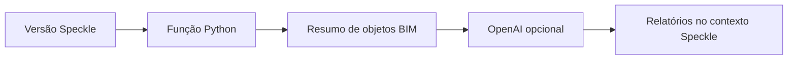

 |  | 

# Aurora Kids I.D. — Função Speckle Automate

## Visão geral

O README atual descreve soberania digital, IA e blockchain para proteção de crianças e adolescentes, mas não documenta um produto implementável nessa área. O código presente é uma função Speckle Automate em Python que recebe um objeto BIM, o percorre/contabiliza tipos e algumas ocorrências de estrutura sem material, envia um resumo e um prompt à API OpenAI usando gpt-4o-mini e armazena um relatório Markdown no contexto do Speckle. Não há implementação visível de identidade infantil, blockchain, DNS seguro, filtragem de conteúdo ou processamento offline/local.

## Objetivo e valor

**Problema/escopo:** Função Speckle Automate em Python que resume dados BIM e solicita análise à API OpenAI.

**Valor verificável hoje:** o repositório torna explícitos seus artefatos, interfaces e limitações para que mantenedores e contribuidores possam avaliar o que existe sem confundir demonstração, proposta e produção.

## Arquitetura e tecnologias

Função de automação Speckle: main.py define FunctionInputs e automate_function; recebe a versão por AutomationContext.receive_version(), percorre objetos com flatten.py, monta resumo/regras locais, chama OpenAI chat completions e marca sucesso/falha e salva relatorio_aurora.md via contexto. main.py tem entrypoint execute_automate_function. O workflow publica como Speckle Automate. Sem serviços adicionais ou arquitetura de sistema documentados; classificar como função/integrador, não arquitetura mais ampla.

- Python; o GitHub também contabiliza Dockerfile nos metadados de linguagens.
- Python >=3.11 no pyproject.toml; Dockerfile e mise.toml especificam Python 3.11; o workflow usa Python 3.13.
- Dependências declaradas: specklepy, speckle-automate, openai e pydantic; opcionais de desenvolvimento: mypy, pytest e ruff.
- Container Docker baseado em python:3.11-slim.
- Metadados de pacote no pyproject.toml ainda identificam o projeto como speckle-automate-function, com descrição de template Speckle Automate.
- Não há evidência de framework web, frontend, banco de dados ou blockchain no código listado.

## Início rápido

Os comandos abaixo refletem instruções, manifestos ou pontos de entrada presentes no repositório. Dependências externas, segredos e serviços estão indicados quando aplicável; a presença de um comando não equivale a uma execução validada.

1. O README não oferece instruções de instalação ou início rápido. O workflow público executa `pip install .[dev]` após configurar Python 3.13; isso comprova o comando configurado no CI, não uma instalação testada na revisão estática do repositório.
2. O workflow executa `python main.py generate_schema ${HOME}/functionSchema.json` para gerar schema.
3. Para publicação, o workflow configura o comando `python -u main.py run` na ação Speckle Automate; depende de SPECKLE_FUNCTION_TOKEN e SPECKLE_FUNCTION_ID. É configuração de CI, não instrução de execução local independente.
4. O repositório contém tests/test_function.py e pytest como dependência dev, mas o workflow examinado não executa pytest; nenhum resultado de testes foi verificado.

## Exemplo de uso

Exemplo da interface efetivamente declarada: construir `FunctionInputs(openai_api_key=SecretStr("..."), analysis_prompt="Resuma a distribuição de tipos BIM")` e fornecê-la à função `automate_function(automate_context, function_inputs)` em contexto Speckle Automate. Não é exemplo autônomo: requer AutomationContext/Speckle e chave OpenAI. O arquivo example.function_inputs.json usa campos de outro contrato e não serve como exemplo válido para a FunctionInputs atual.

## Estado e limitações

**Maturidade indicada:** Experimental.

- Não apresentar o projeto como sistema de proteção infantil, identidade soberana, blockchain, DNS seguro ou solução offline/local com base no código atualmente listado; essas alegações não são sustentadas pela implementação examinada.
- O código envia resumo de dados BIM e prompt a OpenAI, modelo gpt-4o-mini, portanto não comprova processamento local. Avaliar privacidade/segurança dos dados e credenciais antes de qualquer uso real.
- Há forte incompatibilidade entre testes e implementação: test_function.py instancia FunctionInputs com forbidden_speckle_type e whisper_message, inexistentes na classe atual, que exige openai_api_key. Não afirmar que testes passam.
- example.function_inputs.json também usa whisperMessage e forbiddenSpeckleType, divergentes dos campos atuais openai_api_key e analysis_prompt.

## Contribuição

Leia [CONTRIBUTING.md](CONTRIBUTING.md) antes de abrir uma issue ou pull request. Para reportes de segurança, siga a orientação específica do repositório, se houver.

## Licença

Este repositório está licenciado sob **MIT**; consulte [LICENSE](LICENSE).

## Patrocínio e apoio

O desenvolvimento aberto exige tempo para manutenção, documentação, testes, revisão de contribuições e resposta a issues. Se este projeto for útil, considere apoiar a continuidade pelo [GitHub Sponsors](https://github.com/sponsors/felipetjmg1-bit). O apoio não representa promessa de funcionalidades, prazo de entrega ou suporte comercial.

